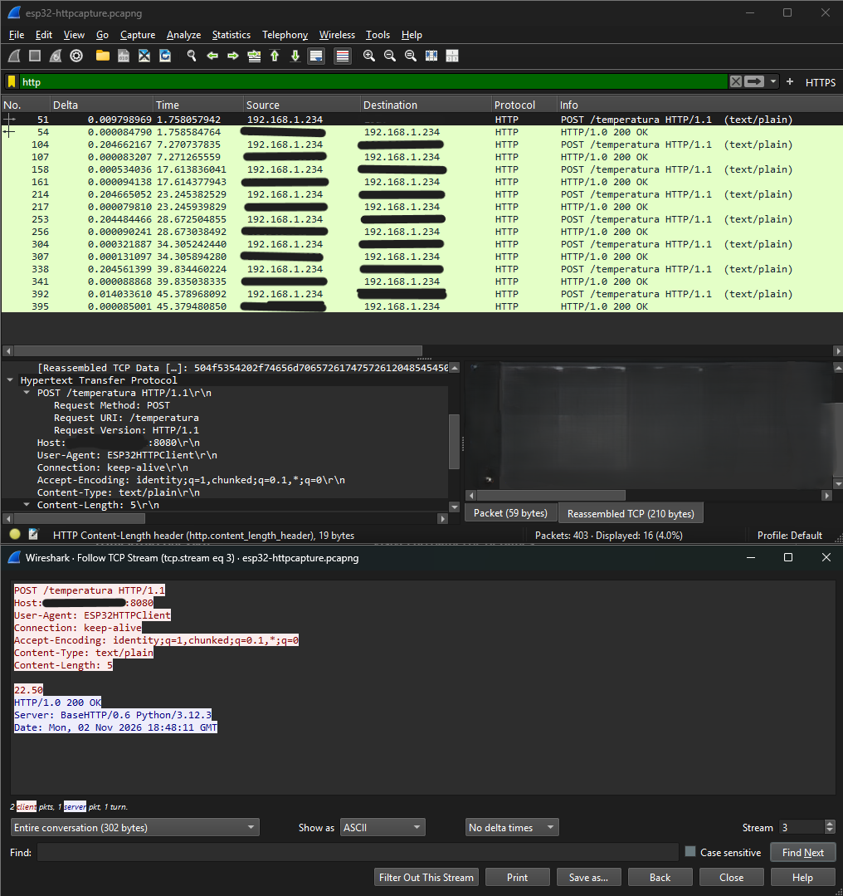
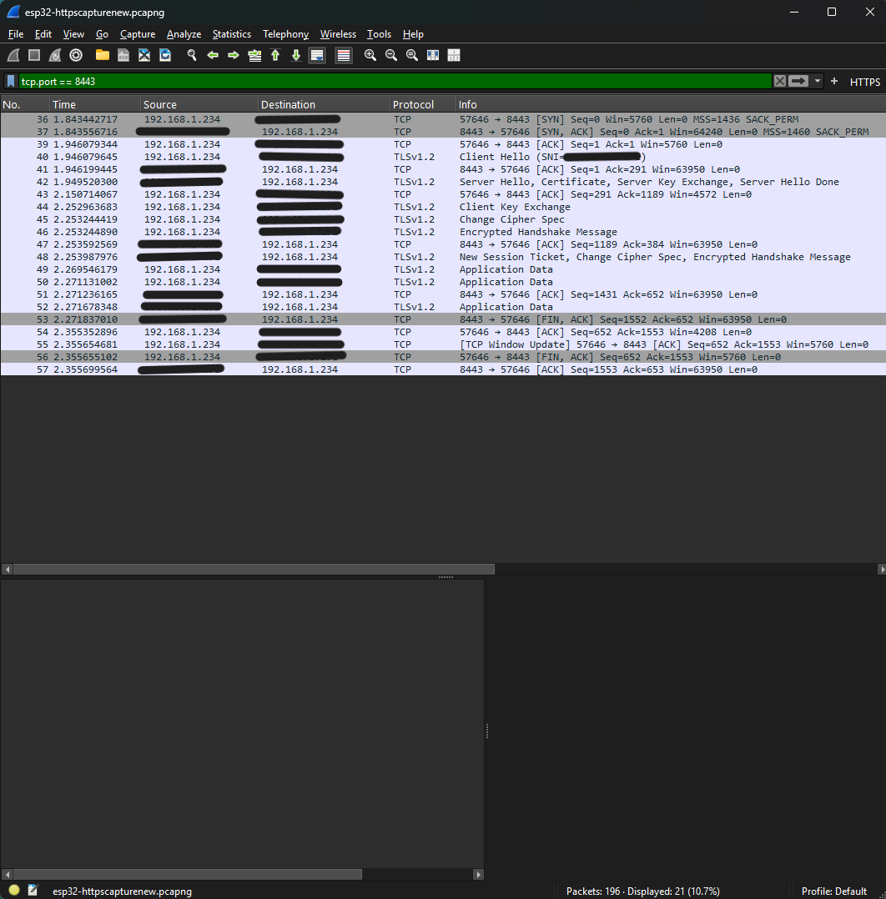

# HTTP vs HTTPS: Network Traffic Comparison

## Project
A small ESP32 device reads temperature from a DHT22 sensor and sends the
reading to a local Python server every few seconds. The goal of this test
was to see, with real packet captures, how choosing HTTP versus HTTPS
changes what an observer on the same network can see.

## Setup
- ESP32 DOIT DevKit sending temperature readings via HTTP POST
- Python server receiving the readings on a local network
- Wireshark capturing traffic on the same Wi-Fi network
- Second test repeated with TLS enabled (self-signed certificate), same
  sensor and same server logic, different port

## Test 1: HTTP (no encryption)

**File:** `esp32-httpcapture.pcapng`
**SHA-256:** `ad5c21881e9fdd1fe54c087b4ebdfe95f506f7dabe3b85f692362a1bb8962516`



The request body was fully readable in the capture:

```
POST /temperatura HTTP/1.1
Host: [server-ip]:8080
User-Agent: ESP32HTTPClient
Content-Type: text/plain
Content-Length: 5

22.70
```

Anyone capturing traffic on the same network could read the exact
temperature value sent by the device, with no extra tools or effort.
This also exposed the request path, the server's internal address, and
the fact that a Python server was handling it.

## Test 2: HTTPS (TLS encryption)

**File:** `esp32-httpscapturenew.pcapng`
**SHA-256:** `587a5146c516c610c18f78de00b235e2cd9a61613e207176c91eba837fa2c2f1`



The `Application Data` label (instead of a readable protocol like HTTP)
confirms the content is encrypted. The decrypted bytes themselves were
intentionally excluded from this report, since even unreadable TLS
handshake data can retain fragments of certificate metadata, such as
the server's IP address used as the certificate's Common Name.

The same device, sending the same kind of data, now produced this
sequence instead:

| Step | What happens |
|---|---|
| 1 | TCP connection opens (SYN, SYN-ACK, ACK) |
| 2 | Client Hello — device starts the TLS negotiation |
| 3 | Server Hello — server replies with its certificate |
| 4 | Client Key Exchange, Change Cipher Spec |
| 5 | Both sides confirm the encrypted channel is ready |
| 6 | Application Data — the actual temperature reading, now encrypted |
| 7 | Connection closes |

Trying to read the content of step 6 produces unreadable bytes. No
request path, no header, and no temperature value is visible in plain
text anywhere in this capture.

## Side-by-side comparison

| | HTTP | HTTPS |
|---|---|---|
| Temperature value visible | Yes, in plain text | No |
| Request path visible (`/temperatura`) | Yes | No |
| Server software visible | Yes (Python version) | No |
| Setup effort | None | Certificate generation, code changes |
| Performance | Faster connection | Extra handshake steps, slightly slower on a small device |

## What this shows

Without encryption, any device on the same Wi-Fi network can read the
data being sent, simply by capturing traffic. This is a common issue in
low-cost IoT devices, where simplicity is often chosen over security.

Adding TLS, even with a self-signed certificate rather than one from a
public certificate authority, hides the content of every message. The
trade-off is a small amount of extra setup and a slightly heavier
connection process, which matters more on constrained hardware like a
microcontroller than on a regular computer.

## Note on certificate trust

This test used a self-signed certificate, and the device was configured
to accept it without checking who issued it. This keeps the data private
from anyone reading the traffic, but it does not confirm that the device
is talking to the correct server — a more complete setup would pin the
expected certificate in the device's code so it refuses to connect to an
impostor server.

## Next steps
- Pin the server certificate on the device instead of skipping
  verification
- Add authentication so the server only accepts requests from a known
  device
- Repeat this comparison using MQTT with and without TLS